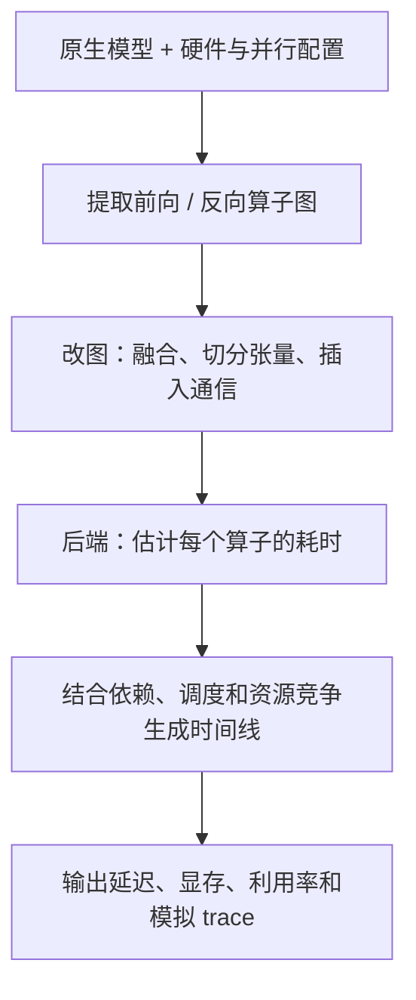

# Charon 方法与实验笔记

论文：[Charon: A Unified and Fine-Grained Simulator for Large-Scale LLM Training and Inference](./Charon.pdf)；ByteDance Seed / UT Austin。本文依据本地 PDF（arXiv:2605.17164v2，2026-05-19）整理。

**一句话：把真实模型拆成算子图，估计每个算子的耗时，再按多卡执行规则排出时间线，用较低成本试出更合适的训练、推理配置。**

## 1. 问题本质：大模型调优贵在“每个方案都要上集群试”

部署一个模型，需要同时决定用什么 GPU、用多少张卡、模型怎么切、batch 多大、计算与通信怎么重叠。这些参数互相影响：多用几张卡可能让计算更快，也可能因为通信变多而得不偿失。

传统流程是：

```text
选一组配置 → 在集群上跑 → 看 profiler → 改配置 → 再跑
```

问题不在于 profiler 看得不够细，而在于**每次获取结果都得真正占用集群**。配置组合一多，测量成本就难以承受。

Charon 希望提前回答这些问题：把 TP 从 4 改成 8 会不会更快？融合几个算子能省多少时间？换一种流水线调度，会少等多久？某种配置会不会显存溢出？

它仍然需要真实 profiling 来提供算子数据和硬件校准，但可以复用这些数据，减少整套模型在大集群上的反复试跑。（§1–2，pp.1–4）

## 2. 核心思路：像编译器一样，逐步把模型变成“执行计划”

> The key insight is to treat LLM simulation as a compiler-style transformation process.

这里的“像编译器”可以理解为：每一步只负责改好执行计划的一部分。先知道模型要算什么，再决定怎么分给多张卡，最后决定什么时候执行。



这样设计有两个直接好处：

- **新优化可以通过改图来试。** 比如想研究融合，把图中的几个节点替换成一个融合节点，再给它配上耗时模型。
- **训练和推理可以共用基础设施。** 两者的图和调度不同，但都能交给同一套算子估时、通信建模和时间线分析模块。

注意，模拟融合的收益仍然需要融合算子的性能模型；仅仅把节点合并，并不会自动知道新 kernel 有多快。（§3.1，pp.4–5；§5，p.11）

## 3. 前端：把模型变成足够接近真实执行的算子图

### 3.1 直接从 PyTorch 模型提取前向和反向图

Charon 接收 Hugging Face、vLLM 或自定义 PyTorch 模型，通过 FX tracing 和 `torch.compile` 相关流程提取算子结构。训练还需要反向传播：它加入占位输入和损失函数，利用 AOT Autograd 生成前向、反向联合图，再拆开并清理。

这省去了手工在模拟器中重写模型的工作。

对于重复结构的 Transformer，可以复用单个 block 的模拟结果来加速。**这不等于所有模型都只算一层再乘层数**：不同层结构不一致，或者需要建模流水线并行时，论文会分别追踪相关层，并显式安排各张卡的执行和跨阶段依赖。Prefill 和 decode 也可以分别建图，用于模拟两阶段部署在不同硬件上的情况。（§3.2(a)，p.5）

### 3.2 用 pass 修改图：每个 pass 负责一种优化或并行策略

Pass 就是“一轮有明确目的的图处理”。例如，融合 pass 找到指定算子组合后，用融合算子替换；量化 pass 改变节点精度；并行 pass 则改变张量大小并插入通信。

| 并行方式 | 通俗理解 | 模拟器需要改什么 |
|---|---|---|
| TP：张量并行 | 一个大算子分给多张卡计算 | 修改算子输入形状，插入 all-reduce 等通信 |
| EP：专家并行 | 不同卡负责不同专家 | 表达专家切分及相应的数据交换 |
| SP：序列并行 | 沿 token / 序列维度分工 | 修改局部计算形状，插入所需通信 |
| PP：流水线并行 | 不同卡负责不同层，分批接力执行 | 划分阶段，插入 send/recv，建立阶段间依赖 |
| DP / FSDP / ZeRO | 分担样本，或进一步分摊参数、梯度和优化器状态 | 建模同步、状态切分及预取等开销 |

例如，TP 增大后，本地矩阵乘可能变小、变快，但同步通信会变化。因此不能把单卡耗时直接除以卡数。Charon 会把这些计算和通信一起放进图中。PP 则进一步支持 1F1B、DualPipe 等调度。（§3.2(b)，pp.5–6）

### 3.3 显存要看“哪些张量同时活着”

把所有张量的大小加起来，不等于峰值显存：有些临时张量早就释放了，有些激活却必须留到反向传播。

Charon 沿着计算图分析张量何时产生、最后一次使用、何时可以释放，再结合权重、梯度、优化器状态和临时缓冲区，估计峰值。直观上可以写成：

$$
M_{\mathrm{peak}} \approx \max_t
\left[M_{\mathrm{persistent}}(t) + M_{\mathrm{live\ tensors}}(t) + M_{\mathrm{buffers}}(t)\right]
$$

这是帮助理解的概括式，不是论文给出的完整实现公式。真实显存还受内存池保留、碎片和通信库缓冲区影响；论文实验也加入了这些因素的校准。

此外，分析的先后顺序很重要。例如重计算会增加实际执行的 FLOPs，但计算模型本身的 FLOPs 时，应在加入重计算之前统计，避免混淆“模型需要的工作”和“为省显存多做的工作”。（§3.2(c)，pp.6–7；§4.3，p.10）

## 4. 后端：一个算子要多久，用三种办法互相补位

| 后端 | 怎么估计耗时 | 好处 | 主要局限 |
|---|---|---|---|
| Profiling | 在目标硬件运行算子，测量并缓存结果 | 对已测实现和形状最有依据；命中缓存后很快 | 建库需要真实硬件和测量成本 |
| Prediction | 用 profiling 数据训练每类算子的随机森林，输入类型和形状预测耗时 | 未测过的形状也能快速估计 | 准确度依赖训练数据覆盖范围 |
| Analytical | 根据计算量、访存量、硬件和网络模型估算 | 缺少测量数据时仍可给出估计 | 难以完整描述复杂 kernel 的实现细节 |

### 4.1 三种办法的关系：测过就复用，没测过就预测，缺数据就估算

假设前端经过 TP 切分后，得到一次矩阵乘：

$$
A_{M\times K} B_{K\times N} \rightarrow C_{M\times N}
$$

后端要回答的是：在指定硬件、精度和实现条件下，这次运算需要多少微秒？它不需要算出矩阵 C 的实际数值。

- **Profiling：** 真正执行这个算子，记录耗时；以后遇到可复用的配置，直接查表。
- **Prediction：** 这组形状没有测过，但已有同类算子的测量数据，让一个小模型估计耗时。
- **Analytical：** 没有合适的实测或预测支持，就根据运算量和硬件能力粗估。

后两种办法节省的是新增形状的测量成本。预测器的训练数据本身仍来自真实测量，并不是不需要 GPU 就能凭空知道 GPU 性能。

“测过就复用”是帮助理解的工作方式；Charon 实际如何选择后端，还取决于后端的支持范围和优先级，见 §4.8。

### 4.2 Profiling：先建立“什么算子、什么形状、耗时多少”的数据表

论文的 profiling engine 会生成算子测量任务，在目标 GPU 集群上运行，并缓存结果。可以把数据表理解成下面这样。**以下数字全部用于演示，不是论文实测值；硬件、精度和 kernel 实现假设固定。**

| 算子 | M | N | K | 实测耗时（μs，示意） |
|---|---:|---:|---:|---:|
| Linear | 64 | 4096 | 4096 | 12 |
| Linear | 128 | 4096 | 4096 | 18 |
| Linear | 256 | 4096 | 4096 | 30 |
| Linear | 512 | 4096 | 4096 | 54 |

遇到已经测过的 M=128，可以复用 18 μs。遇到没测过的 M=192，则没有可以直接查出的答案。

一种选择是再运行一次真实测量；另一种选择是交给预测器。配置搜索可能产生大量新形状，如果每个都重新测，GPU 调度、启动和测量成本就会积累起来。这正是 prediction engine 的用途。

实际测量还需处理 GPU 异步执行、预热和计时噪声；这是实施 profiling 时应考虑的通用问题。论文此处没有完整公开这些测量细节。

### 4.3 随机森林到底学什么：从输入形状到耗时的映射

论文明确写道：

> Each type of operator is associated with a compact random-forest–based predictor trained on data from the profiling database.

也就是说，可以把它理解成“Linear 有自己的预测器，RMSNorm 有自己的预测器，Attention 有自己的预测器”。这里预测的是连续数值——耗时，因此使用的是**随机森林回归**，不是分类。

以矩阵乘为例，训练任务可以概括为：

$$
\mathbf{x}_i = (M_i,N_i,K_i), \qquad y_i=T_i^{\mathrm{measured}}
$$

$$
\widehat{T}=f_{\mathrm{Linear}}(M,N,K)
$$

输入是形状相关特征，标签是实测耗时。训练结束后，输入一个新形状，模型输出预测耗时。算子类型可以用于选择对应的预测器，不一定需要作为一个数字再塞进每棵树。

**上述 M/N/K 是用于理解 Linear 的特征示例。论文只明确了“算子类型和输入张量形状”，没有公开完整特征编码。** 是否额外加入 FLOPs、访存量、对齐信息，是否对耗时取对数，不能从正文确定。

Attention 还涉及序列长度、head 数、head dimension、KV 长度等参数；具体实现如何编码它们，论文同样没有充分展开。

### 4.4 一棵回归树怎样预测：按条件分组，每组给一个耗时

先不考虑“森林”，只看一棵树。它的形态类似一组自动学出来的 if/else：

```text
输入一个 Linear 的形状
    │
    ├─ M 比某个阈值小？
    │     ├─ 是：继续判断 K 是否较小
    │     │       ├─ 是：到叶子 A，输出这一组样本的平均耗时
    │     │       └─ 否：到叶子 B，输出另一组样本的平均耗时
    │     └─ 否：继续按 N、K 等特征划分
    │
    └─ 最终走到一个叶子，得到一个预测值
```

这些阈值通常由训练算法寻找，而不是工程师手写。标准平方误差回归树会尝试不同的特征和切分点，选择能让组内耗时差异更小的划分。

例如，一组样本里既有十几微秒的小矩阵，也有几百微秒的大矩阵，用一个平均值代表全部样本显然不好。树会尝试把它们分开，再在每组内部继续细分。最终，每个叶子代表一片形状范围。

训练时可以反复比较切分方案；预测时只需要沿着已经建好的树做几次大小比较，所以很快。它没有实际执行矩阵乘，也没有读取这个矩阵的每个元素。

这里描述的是标准回归树的常见机制；Charon 没有披露具体切分损失、树深度或叶子大小设置。

### 4.5 为什么需要“森林”：让多棵有差异的树一起估计

单棵树容易受测量噪声、个别样本或一次切分决定影响。随机森林训练多棵树，让它们各自估计，再汇总结果。

标准随机森林通常通过两种方式制造差异：

1. 每棵树对训练样本做有放回抽样，因此看到的数据组合不同。
2. 切分节点时，可以只考虑随机选取的一部分特征，减少不同树之间的相似性；实际是否使用、用多少，取决于配置。

对于常见的回归森林，最终输出是各棵树预测的平均值：

$$
\widehat{T}(\mathbf{x})=\frac{1}{B}\sum_{b=1}^{B}h_b(\mathbf{x})
$$

$B$ 是树的数量，$h_b$ 是第 b 棵树。例如三棵树分别预测 20、24、22 μs，平均就是 22 μs。这个数字也是示意。

可以把它理解成：同一批实测资料被整理成多套不同的分组规则，预测时综合这些规则，降低单套规则偶然判断失误的影响。

**“随机”主要发生在训练阶段；训练完成、模型固定之后，对同一个输入的预测通常是确定的。** 它不是每次随便猜一个耗时。

### 4.6 为什么适合这里，以及哪些情况会失效

形状到耗时的关系往往不平滑：形状稍微变化，可能触发不同的 kernel 路径、分块方式或并行效率。树可以用不同区间表示不同表现，不必假设所有形状都遵循一条简单直线。小型森林的查询又很便宜，适合在配置搜索中反复调用。

从论文图 10 看，预测后端在未见形状上的误差确实较小，尤其是 FlashAttention-3：分析后端的 MAE 为 31.84%，预测后端为 2.22%。不过，这证明的是该实验数据范围内的效果；论文没有通过与其他回归方法的比较，证明随机森林就是最好的选择。

使用时要留意四个边界：

- **新形状不等于任意外推。** 在已经覆盖的形状范围里补充未测点，与预测比训练样本大几十倍的形状，是两件事。标准回归森林在叶子输出样本均值，缺乏可靠的外推能力；超大输入可能仍落入已有叶子，得到过小的耗时。
- **同形状不等于同性能。** 换 GPU、精度、kernel 实现、布局或软件版本，耗时都可能变化。需要相应数据或额外区分；不能默认一个形状预测器自动跨硬件、跨实现通用。
- **它不会主动理解数据内容。** 如果耗时受稀疏分布、MoE 路由等数据相关行为影响，而这些信息没有进入特征，单靠形状无法充分区分。
- **多棵树不自动构成可靠的置信度。** 树之间预测很接近，也可能是它们一起遇到了训练范围以外的输入。论文没有描述基于置信度的回退策略。

此外，论文没有给出每类算子的完整训练数据规模与采样规则、训练 / 测试划分细节、树的数量与深度、硬件与精度如何区分模型等信息。图 10 的 N 是所展示的未见算子形状测试数量，不能当成完整训练集大小。

### 4.7 分析后端：用计算量、访存量和网络模型估算

**计算算子使用 Roofline 作为基本估计。**

分析后端分别估计做计算、搬数据需要多久，取较大的那个：

$$
T_{\mathrm{op}} \approx
\max\left(\frac{\mathrm{FLOPs}}{\mathrm{Compute\ throughput}},
\frac{\mathrm{Bytes\ moved}}{\mathrm{Memory\ bandwidth}}\right)
$$

直观理解：算得很快也得等数据，数据来得很快也得等计算。

但硬件峰值不能完整反映一个具体 kernel 的调度、访存和执行效率，所以复杂算子尤其需要实测或学习型预测。论文并不是只靠 Roofline 就获得了全部精度。（§3.3，p.7）

**通信算子沿实际链路算，而不是只填一个总带宽。**

Charon 把 all-reduce 等集合通信拆成底层链路上的数据传输，支持 Ring、Tree 算法以及不同网络拓扑。每条链路的耗时由启动 / 握手延迟和数据传输时间组成，还要考虑共享链路上的竞争。

**这里使用的是通过 profiling 校准的有效带宽和逐跳延迟。** 因而“分析模型”也依赖硬件校准，不能理解成只抄 GPU、网卡的标称参数就能精确预测。（§3.3(c)，pp.7–8）

### 4.8 混合后端：按支持情况选择，缺数据时逐级回退

Fused engine 在一次模拟中可以给不同算子使用不同后端。图 5 展示的优先路径是 profiling → prediction → analytical；正文将它概括为按后端注册的支持范围和优先级进行回退。

这里的 fused 指**混用估时方法**，与前端把多个算子融合成一个 kernel 是两回事。不同精度也需要对应的算子数据或分析估计，并影响显存和通信量。（§3.3(d)，pp.7–8）

还有两个容易混淆的地方：

- **查表未命中，不一定意味着立即转预测。** Profiling engine 本身可以发起新的真实测量；图 5 判断的是后端是否支持该算子，而不只是缓存是否命中。正文没有完整给出“新增测量还是立即预测”的调度策略。
- **随机森林不是整台模拟器。** 在论文的模块划分里，它负责单算子耗时预测；计算与通信重叠后的减速、跨卡依赖和端到端时间线，由其他模块处理。随机森林部分也没有给出足够细节，让我们断言所有集合通信耗时都由它预测。

整条数据流可以这样理解：

```text
真实算子测量 → profiling 数据库 → 按算子类型训练随机森林
                    │                         │
                    ↓                         ↓
               复用已有测量              估计未测形状
                    └──────────┬──────────────┘
                               ↓
                  得到单算子的基础耗时
                  （缺少支持时可用分析后端）
                               ↓
                  结合重叠、依赖、调度生成时间线
```

§4.1–4.8 的论文依据主要是 §3.3、图 5（pp.7–8）以及 §4.4、图 10（pp.10–11）。树的训练过程、示例数据和外推性质是为理解该方法补充的通用知识，并非论文公开的实现细节。

## 5. 最关键的细节：同时执行，不代表彼此没有影响

假设计算单独跑需要 10 ms，通信单独跑需要 6 ms。串行是 16 ms；如果两者完全重叠且互不影响，才可能是 10 ms。实际执行中，它们可能争用 GPU 或访存资源，重叠后各自变慢。

Charon 用两种方法处理这件事：

1. **按实测比例减速。** 根据目标集群 profiling 得到减速系数，只对真正重叠的时间段应用。计算与通信可以使用不同系数；通信与通信的粗粒度模型使用共享系数。
2. **按共享链路带宽计算。** 对使用分析后端的通信—通信重叠，检查每一段重叠期间，各层互连有哪些传输在竞争，再分配有效带宽。

举个帮助理解的例子：两次传输同时走同一条有效带宽为 50 GB/s 的链路，不能让它们各按 50 GB/s 前进。在两者均分带宽的简化情况下，各为 25 GB/s；等其中一个结束，另一个才能恢复速度。

这些变化还会影响后续算子的启动时间，因此**端到端耗时要从修正后的依赖与执行时间线得到，不能把单独测得的算子耗时直接相加**。

范围也要分清：论文的细粒度带宽竞争模型针对通信—通信；计算—通信仍使用基于 profiling 的比例模型。它近似网络拥塞的影响，没有逐个模拟网络包。（§3.4，p.8）

## 6. 配置搜索：用模拟筛方案，省下上机试错成本

用户提供模型、任务和候选范围，例如 GPU 数量、TP/PP 大小、batch size。Charon 遍历候选配置，并允许用预先定义的规则跳过已知低效的组合。

对于推理，目标通常可以概括为：

$$
\max_c \; \mathrm{TPS/GPU}(c)
\quad \text{subject to}\quad
\mathrm{TTFT}(c) \leq S_{\mathrm{first}},
\quad \mathrm{TPOT}(c) \leq S_{\mathrm{token}}
$$

- TTFT：用户发出请求后，等多久看到第一个 token。
- TPOT：后续平均隔多久生成一个 token。
- TPS/GPU：平均每张 GPU 每秒处理多少 token，反映硬件效率。
- $c$ 是配置，$S$ 是服务要求。上式是对论文目标的概括。

batch 大一些通常能提高总吞吐，但也可能让单个用户等得更久，因此要在满足体验要求的配置里选效率高的。

**论文描述的是带规则剪枝的配置搜索，没有给出保证找到全局最优的算法或证明。** 结果依赖候选范围、剪枝规则和模拟精度。（§3.5，pp.8–9；§5.2，pp.12–13）

## 7. 实验怎么读：既看整体结果，也看数字的适用范围

### 7.1 端到端与跨硬件验证

论文使用 Qwen3-8B、LLaMA3-8B 和 MoE 模型 Qwen3-30B-A3B。训练覆盖 Megatron、VeOmni，对比 ASTRA-Sim 2.0、SimAI；推理覆盖 vLLM，对比 Vidur。作者说明修复了基线的小问题、适配相关模型，并用 profiling 重新校准。（§4.1，图 7，p.9）

跨硬件实验覆盖 H800、A100 训练 GPU，以及 H20、L20 推理 GPU，所测配置的端到端误差绝对值不超过 4.98%。跨集群规模实验中，图 11 的误差依次为 +0.71%、+2.06%、−5.35%、−3.74%；其中一个超大规模训练点约为 −3.74%。（§4.5，图 11，p.11）

因此，摘要里的“5.35%”“3.74%”应理解为论文所测场景的结果，**不是对任意模型、形状、硬件和算子的统一误差保证**。图中其他大规模点仍出现 −5.35%，不能写成“大规模训练全部低于 3.74%”。

### 7.2 端到端准，不等于每个算子都准

表 2 给出 Qwen3-8B 的计算、通信分项。Prefill 的 attention 实测 3923 μs、模拟 3906 μs，非常接近；但 decode 阶段存在明显相对误差：

| Decode 分项 | 实测（μs） | 模拟（μs） | 相对误差，按表中数据计算 |
|---|---:|---:|---:|
| Attention | 58.206 | 72.1 | 约 +23.9% |
| Feed-Forward | 93.47 | 109 | 约 +16.6% |
| Others | 6.84 | 12 | 约 +75.4% |

小算子的绝对误差可能不大，相对误差却很高。表 2 是分组统计，也没有展示每一个底层 kernel 的误差。因此，用它做系统配置筛选和用它判断某个小 kernel 是否优化成功，要求并不相同。（§4.2，表 2、图 8，p.10）

### 7.3 后端消融：学习型预测对复杂算子更有用

图 10 测试未见过的张量形状，报告的平均绝对百分比误差如下（图中记为 MAE）：

| 算子 | 测试数量 | 分析后端 | 随机森林预测后端 |
|---|---:|---:|---:|
| Linear | 390 | 6.60% | 1.44% |
| RMSNorm | 80 | 5.70% | 1.12% |
| FlashAttention-3 | 80 | 31.84% | 2.22% |

这支持“实测数据训练的预测器能补上简单分析模型的不足”，尤其是复杂 kernel。不过这里只比较了分析与预测后端，还不能单独证明图变换、重叠模型、缓存、搜索剪枝等每个组件贡献了多少。（§4.4，pp.10–11）

### 7.4 显存验证：结果很准，但依赖具体场景和校准

Qwen3-30B-A3B 在 8 卡、FSDP=8、batch size=2、序列长度 8192 的训练中，峰值 allocated、峰值 reserved 和 total memory 的相对误差分别为 +0.39%、+0.29%、−0.03%。

其中 allocated 是已分配给张量等对象的内存，reserved 是内存池保留的内存，两者不能混用。该实验还校准了通信缓冲区开销和碎片效应；这一组很小的误差不能直接外推到所有模型和运行时。（§4.3，图 9，p.10）

### 7.5 两个落地案例：模拟确实能帮助做决策

**案例一：按请求选择序列并行方案。** 长序列值得分给多卡算；短序列拆得太细，通信可能比省下的计算还贵。Charon 在一个 batch 内给不同请求选择不同的 SP 和 zigzag 切分方式。LLaMA-3 70B 在 8 张 Ada Lovelace 推理 GPU 上，相比静态 zigzag 基线，attention block 延迟平均下降约 15%。这里的 SP 用于 attention 的序列分工，需结合此处的具体含义理解。

**15% 是 attention block 的结果，不是整个模型端到端加速 15%。**（§5.1，图 12，p.12）

**案例二：寻找用户速度与 GPU 吞吐之间更好的取舍。** 论文称相关配置分析通常可在两分钟内完成，依靠预先测好的 kernel 数据和多进程模拟。图 13 中，放宽用户侧 token 速度要求，最优前沿上的 TPS/GPU 最多可增加约 7 倍。

**7 倍来自不同用户速度要求之间的取舍，不是相同 SLO 下相对人工基线提升 7 倍。** 另一个固定输出长度、端到端延迟要求为 100 ms 的生产案例称优于人工调参，但未给出具体提升比例。两分钟也不包含从零建立 profiling 数据库的完整成本。（§5.2，图 13，pp.12–13）

## 8. 对我们做 Profiling / KernelAgent 的启发

以下是阅读后的应用推论，不是论文已经验证的 KernelAgent 方案。

### 8.1 评估 kernel 优化时，要看它在完整执行中的位置

单个 kernel 变快，最终能省多少时间，还取决于它是否处于决定整体完成时间的依赖路径上，以及它有没有被通信或其他工作覆盖。可以借鉴 Charon 的做法，把局部估时放回执行图中，判断真正暴露出来的收益。

### 8.2 建立“实测数据复用 + 快速预测 + 分析兜底”的评估流程

反复出现的算子和形状可以复用测量；没测过的形状先用预测；缺少数据时再用分析模型粗筛，最后对重要候选做真实测量。

但对代码生成 agent，还必须区分**不同 kernel 实现**。相同算子类型、相同输入形状，可以有完全不同的代码和性能。Charon 面向已建模算子、依据类型和形状预测的思路，不能直接拿来评价任意新生成的 kernel。若实现、硬件或编译条件变化，原来的缓存和预测也需要重新判断是否适用。

### 8.3 实验应证明“选得对”，而不只证明“平均估得准”

如果最终目的是搜索优化配置，建议在误差之外增加以下验证：

- **排序是否可靠：** 模拟选出的前几名，上机后是否仍然领先？最终选中配置比真实最佳配置慢多少？
- **覆盖是否充分：** 分别报告新形状、新硬件、不同算子实现的误差，避免只看一个平均值。
- **收益来自哪里：** 对比不建模重叠、固定比例减速、链路竞争建模，并检查时间线。
- **成本是否完整：** 分开报告 profiling 建库、预测器训练、缓存命中后的模拟和最终实测成本。图 1 宣称的超过 30000 倍单次评估成本节省，也应结合这一口径理解。
- **服务约束是否真的满足：** 平均耗时准还不够；面向在线服务，需要另行验证请求排队、网络抖动和尾延迟。论文承认没有精确刻画微观随机波动，也没有完整展示这些服务指标的验证。

Charon 最值得借鉴的是：**把算子测量组织成可修改、能反映依赖和资源竞争的执行模型，让已有数据支持新的系统决策。**

## 9. 对照项目 roadmap：怎样落到 2.4 优化记录与知识库

本节结合 [项目 roadmap](../../../key/roadmap.md)、[讨论稿](../../../key/roadmap.draft.md) 和 [XSAI emu 使用说明](../../../key/XSAI-emu-guide.md) 提出建议。属于项目方案推论，不是 Charon 已完成的功能。任务编号以 `roadmap.md` 为准。

### 9.1 建模目标要变：从“跑多久”到“下一步怎样改”

Charon 的预测器主要学习：已建模算子在某个形状下需要多久。我们的 Agent 会改变代码，真正需要的是：**给定当前实现、性能现象和平台，尝试某种修改，有多大机会正确且有效？**

可以把数据流设计成：

```text
2.3 / 3.1 / 3.3：复现和优化，持续产生尝试记录
                    ↓
2.4：案例库 → 整理适用条件 → 训练动作收益预测器
                    ↓
当前代码 + 2.2 / 1.2 的性能分析 → 推荐动作与对应案例
                    ↓
Agent 生成代码 → 编译 → 正确性验证 → 性能测量
                    ↓
成功、退化和失败都回写案例库
```

案例库保存证据；知识条目概括适用条件；预测器给动作排序。三者职责不同，可以逐步建立，不必一开始全部完成。

### 9.2 一条训练样本应是一轮完整尝试，而不只是 diff

| 记录部分 | 建议保存的内容 | 用途 |
|---|---|---|
| 实验条件 | 算子、形状、精度、布局、平台、工具链、计时范围；XSAI 还包括 RTL/emu 与内存模型配置 | 保证比较条件一致 |
| 修改前状态 | 父版本代码及标识、原始性能报告、可获得的资源与等待指标、热点位置 | 表达当前问题 |
| 动作 | 原计划、实际 diff、动作类别、参数变化、涉及代码段 | 区分“想怎样改”和“实际改了什么” |
| 验证结果 | 编译成功与否、正确性、耗时或目标周期、重复测量情况、退化及超时原因 | 形成可靠标签 |
| 修改后证据 | 新性能报告、变化最大的指标、人工核验状态 | 解释结果、整理适用条件 |
| 尝试来源 | 运行编号、父子版本关系、搜索策略、LLM/提示版本、为什么尝试此动作、花费 | 去重、划分数据、分析选择偏差和成本 |

LLM 对原因的解释也可以保存，但应标成假设，不能直接当成硬件事实。没有采集到的指标记为缺失，不填零。

**保存修改后信息，不等于可以把它用于修改前的决策模型。** 比如任务是“现在是否应该增加预取”，输入只能使用此刻已有的信息；改完后的 cache miss 降幅应属于结果证据。否则会发生信息泄漏：离线准确率很高，上线时却拿不到所需输入。

### 9.3 随机森林可以先预测动作收益，不必预测任意代码的绝对耗时

先固定一个平台和算子家族，挑选可明确识别的动作，例如改 tile、改循环顺序、改展开因子或增加预取。动作词表允许多标签和“无法明确归类”，不要强行把每次复杂改写都归到一个动作。

可尝试输入：

$$
x=[\text{形状与布局},\text{当前实现特征},\text{修改前性能指标},\text{候选动作及参数}]
$$

先训练一个小型随机森林分类器，估计此次尝试是否“正确且有可确认的提升”；也可在正确、可比的样本上训练回归器：

$$
y=\frac{T_{\mathrm{before}}-T_{\mathrm{after}}}{T_{\mathrm{before}}}
$$

正数表示改善，负数表示退化。若使用 XSAI 目标周期，可在条件一致时以周期替代 T。编译失败和正确性失败应单独记录，不能伪造一个耗时来计算收益；超过测量噪声多大才算改善，应由测量稳定性确定。

模型面对多个候选动作，输出预测或分数，帮助安排尝试顺序。分类器给出的数值未经校准时，不应直接宣传成可靠成功概率；没有尝试过的动作也不能标成失败。数据不足时，先检索相似案例就可以。

如果动作很宽泛、具体代码由 LLM 随机生成，那么学到的是“在当前生成器下尝试这个动作的历史效果”，不是这个动作必然带来的性能收益。需要保存生成器版本；对重点动作尽量从同一父版本做多次对照尝试。

### 9.4 知识条目要保存反例，才能描述适用条件

例如“增大 tile 可以提高数据复用”只能算优化想法。一个可供 Agent 使用的条目应包括：

```text
动作：增大 tile
候选条件：当前实现存在可减少的重复数据搬运，且相关局部资源有余量
预期收益：减少重复搬运，提高复用
可能代价：寄存器、共享内存或其他局部资源占用增加，并行度下降
支持记录：在哪些平台、形状和父版本上有效，收益多少
反例记录：哪些情况下退化，观测到什么变化
验证方法：正确性通过后，测整体耗时并检查资源与访存变化
证据状态：实测支持 / 待验证解释 / 仅来自文献
```

这些是待验证的条件模板，不是通用硬件规律。比如带宽利用率低，可能是访问不连续、并行度不足或问题规模太小，不能直接推导出“应该增大 tile”。

一次 diff 同时改了 tile、布局和流水线，最终提速只能支持该组合；要研究其中某个动作的作用，应回到同一父版本做拆分实验。随机森林的重要性排序和分裂阈值也只是相关性线索，需要结合对照实验核验，不能直接转成因果规则。

### 9.5 与其他子任务的衔接

| 子任务 | 可以从 Charon 借鉴什么 | 我们需要补的验证 |
|---|---|---|
| 1.2 / 2.2 Analyzer | 把测量整理成能供下一步决策使用的结构化信息 | 指标含义、单位、位置与采集范围是否准确；加入分析后是否选得更好 |
| 1.4 内部信息研究 | 检验新增信息是否提高模型与决策效果 | 同一 XSAI 配置下，常规信息与常规加内部信息对比，记录采集成本 |
| 3.2 分段分析 | 依赖和重叠决定局部提速能否转化为整体收益 | 热点段、修改段与整体耗时是否对应；不同阶段能否直接相加 |
| 3.3 KernelBand | 用历史数据为策略选择提供信息 | 先固定选择机制研究知识库，再固定知识库研究选择机制，最后组合 |
| 2.5 多平台优化 | 复用案例格式、分析流程与测量数据库 | 平台专用动作、参数范围、计数器含义分别验证，不照搬 NVIDIA 阈值 |
| XSAI emu / 2.6 模拟器 | 以可信测量校准便宜的估计器，让估计服务候选排序 | XSAI 标签用目标周期等性能量；主机仿真用时是搜索成本。华为工具先明确其实际模型能力 |

XSAI 的优势是可以在固定硬件配置上逐组增加内部信息，直接研究“多知道什么，能少走哪些弯路”。例如增加某组等待/依赖信息后，动作排序是否改善、达到同一性能所需的尝试是否减少。具体指标取决于现有采集覆盖范围，不预设所有部件都已可观测。

### 9.6 最小实验：固定 Agent，逐步加入知识和预测

建议先比较以下四组，保持基础 Agent、任务、模型版本和搜索预算一致：

1. 原流程，不增加新案例库。
2. 加入相似历史案例检索。
3. 加入带适用条件和反例的知识条目。
4. 在第 3 组基础上，加入随机森林动作排序。

分别看固定预算下的最终正确实现性能、有效改写比例、达到相同目标的尝试次数和总成本。不同测量成本的平台应同时报告尝试预算与实际用时；数据采集和训练成本单列。

数据划分应按原始任务及其整个优化谱系分组，不能把同一父版本的近重复子版本散放进训练与测试集。若声称能迁移到新形状、算子家族或平台，分别留出对应组测试；测试任务的记录不能提前进入知识库。

历史记录由既有 Agent 选择哪些动作来试，会有选择偏差。对未覆盖条件只能说缺证据；离线分数之外，仍需要上述真实优化对照实验，并保留一定探索机会，避免预测器长期只推荐已熟悉的动作。

对 1.4 再增加常规信息 / 内部信息的成对实验。特征重要性只能帮助提出候选指标，最终判断某组信息是否值得开放，要看未见任务上的优化收益和获取成本。

### 9.7 对 2.4 工作内容的建议表述

> 建立以单次优化尝试为单位的案例库，保存修改前后代码、输入与平台条件、性能信息、正确性和收益，保留失败与退化案例；整理“当前状态—优化动作—适用条件—结果证据”，先通过检索帮助 Agent，再用随机森林等轻量模型预测动作收益并辅助排序；在未参与建库的任务上验证固定预算下的优化效果和成本。

第一批交付可以是：统一记录格式、一组可复查的成功与失败案例、若干有反例的知识条目、一次固定 Agent 的检索对照实验。随机森林可以作为随后加入的简单基线；是否采用，由数据覆盖和实际效果决定。
