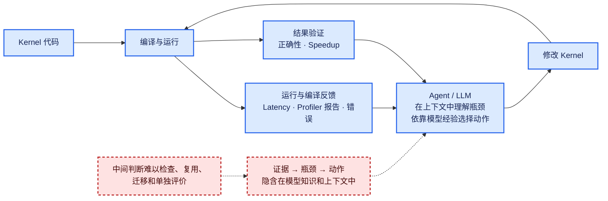
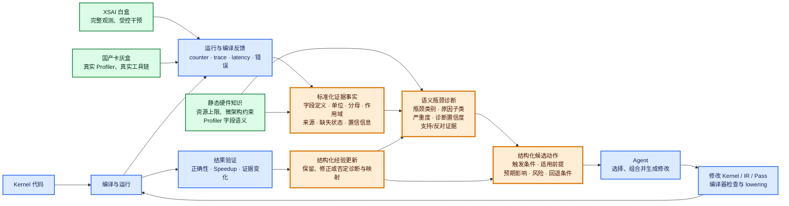

# 传统 Kernel Agent 与 HG-KDA：Profiling 到优化动作的区别

> 图的核心：两类系统共享“生成/修改代码—编译—运行—测量—验证”的基本闭环。HG-KDA 的研究重点是在这个闭环中显式加入“标准化证据事实 → 语义瓶颈诊断 → 结构化候选动作”，并用白盒与灰盒硬件实验验证这条通路。

## 配色含义

- <span style="color:#2563EB">**蓝色：共有环节**</span>——现有 Kernel Agent/KDA 和 HG-KDA 都具备的执行闭环。
- <span style="color:#D97706">**橙色：HG-KDA 的核心研究接口**</span>——本项目需要设计、实现并通过消融实验证明价值的部分。
- <span style="color:#15803D">**绿色：硬件制导基础**</span>——XSAI、国产卡和静态硬件知识为核心接口提供证据与约束。
- <span style="color:#B91C1C">**红色：传统流程中的未显式化部分**</span>——功能可能存在于 Agent 推理中，但没有稳定、可检查的接口。

## 图一：传统 Kernel Agent



## 图二：HG-KDA



这里的橙色不表示这些概念从未出现在任何已有工作中。它表示 HG-KDA 将这些环节作为显式系统接口和主要研究变量，并需要验证它们相对于 raw-counter prompt、latency-only Agent 等基线带来的增益。

## 两个中间层的输出示例

标准化证据层输出的是带有明确测量语义的事实，而不是瓶颈结论：

```yaml
metric: compute.vector_active
value: 0.20
unit: ratio
denominator: kernel_elapsed_cycles
scope: kernel
aggregation: mean
source:
  platform: vendor_A
  raw_metric: vec_pipe_active_cycles
availability: measured
```

语义瓶颈层把多条证据与硬件知识组合成诊断假设：

```yaml
bottleneck: compute_underutilization
subtype: insufficient_parallelism
severity: high
confidence: 0.78
supporting_evidence:
  - compute.vector_active = 0.20
  - execution.occupancy = 0.18
  - scheduler.eligible_work = low
contradicting_evidence:
  - memory.bandwidth_utilization = 0.35
alternative_hypothesis:
  - memory_latency_starvation
```

## 读图时需要区分的三个数值

1. **测量比例**：例如 `vector_active = 20%`。这是带明确分母的观测事实。
2. **瓶颈严重度**：例如 `severity = high` 或归一化分数 `0.8`。这是诊断系统定义的程度，不能解释为 80% 的运行时间。
3. **诊断置信度**：例如 `confidence = 0.78`。这是对诊断可靠性的校准概率或分数，也不是硬件利用率。

由于计算、访存和同步可以重叠，不同瓶颈的严重度通常不能相加为 100%。

## 一句话表述

```text
传统流程：Profiler 输出 → Agent 内部推理 → 代码修改

HG-KDA：平台原始字段
        → 有来源和测量语义的标准化证据
        → 可检查的瓶颈诊断
        → 带适用条件和验证方法的候选动作
        → Agent/编译器执行
        → 用性能与证据变化验证诊断
```
